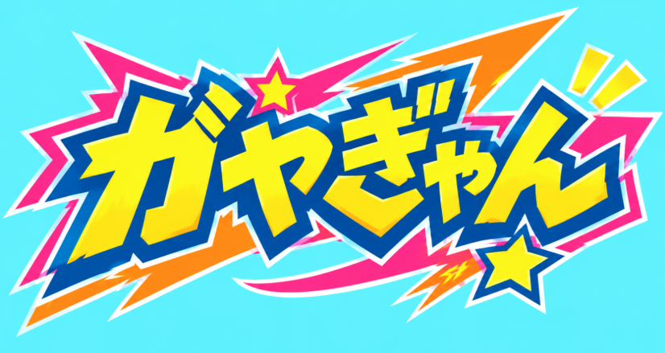

# ガヤぎゃん

## 作品概要

「ガヤぎゃん」は、ハッカソンのキャンプを舞台に、仲間のセリフへタイミングよく「ガヤ」を入れて盛り上げるゲームです。表示される言葉の中からガヤを入れるポイントを見つけ、クリックや音声で反応します。正しいガヤは得点になり、おてつきは減点になります。

Day1〜Day3 のステージを進めるほか、Photon を利用したオンライン対戦も楽しめます。

## 使用技術

- **Unity / C#**：ゲーム本体の開発（Unity 6000.3.8f1）
- **Meshy AI + Blender**：3Dモデルの作成・調整
- **Gemini + Cloudflare**：LLMを利用した問題の生成(Day1)
- **Visual Effect Graph（VFX）**：演出用エフェクトの作成
- **Unity Sentis（Inference Engine）**：音声認識と発話内容の判定(Day3)
- **TextMesh Pro のリッチテキスト**：`<link>` による対象語の識別と、`color`（文字色）による判定結果の表示
- **Photon**：オンライン対戦の実装

## 素材クレジット

| 用途 | 素材・配布元 | 出典 |
| --- | --- | --- |
| 会議室 | CGTrader 掲載の3Dモデル | [CGTrader](https://www.cgtrader.com/items/2981575/download-page) |
| 教卓 | Teacher's Table / CGTrader | [CGTrader](https://www.cgtrader.com/free-3d-models/furniture/table/teacher-s-table) |
| 木目テクスチャ | 木目02 / 建築パース.com | [建築パース.com](https://kenchiku-pers.com/download/88.html) |
| 開発環境の小物 | Low Poly Office Props - LITE / RRFreelance | [Unity Asset Store](https://assetstore.unity.com/packages/3d/environments/low-poly-office-props-lite-131438) |
| キャラクター | めっちゃカメレオン アバター / BR's Shop | [BOOTH](https://booth.pm/ja/items/8562085) |
| フォント | けいふぉんと！ / Do-Font | [すもももじ](https://font.sumomo.ne.jp/font_1.html) |
| フォント | Dela Gothic One | [Google Fonts](https://fonts.google.com/specimen/Dela+Gothic+One) |
| 空・スカイボックス | Stylized Skyboxes FREE / SC Staggart Creations | [Unity Asset Store](https://assetstore.unity.com/packages/2d/textures-materials/sky/stylized-skyboxes-free-302248) |
| タイトル用仮BGM | 学び舎の風景 / 稿屋 隆 | [OpenTracks](https://opentracks.com/bgm/detail/204) |
| リザルトBGM | 見よ、勇者は帰る（表彰の曲） / MMT STUDIO | [MMT STUDIO](https://mmt38.info/jingle/brave/) |
| 効果音・環境音 | OtoLogic | [OtoLogic](https://otologic.jp/free/license.html) |

各素材の著作権と利用条件は配布元に帰属します。フォントのライセンスなど、追加の情報は [使用素材・ライブラリ](Assets/THIRD_PARTY_NOTICES.md) を参照してください。
